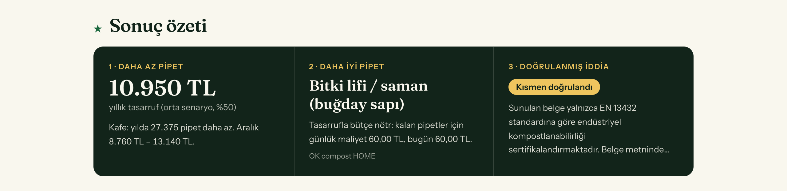
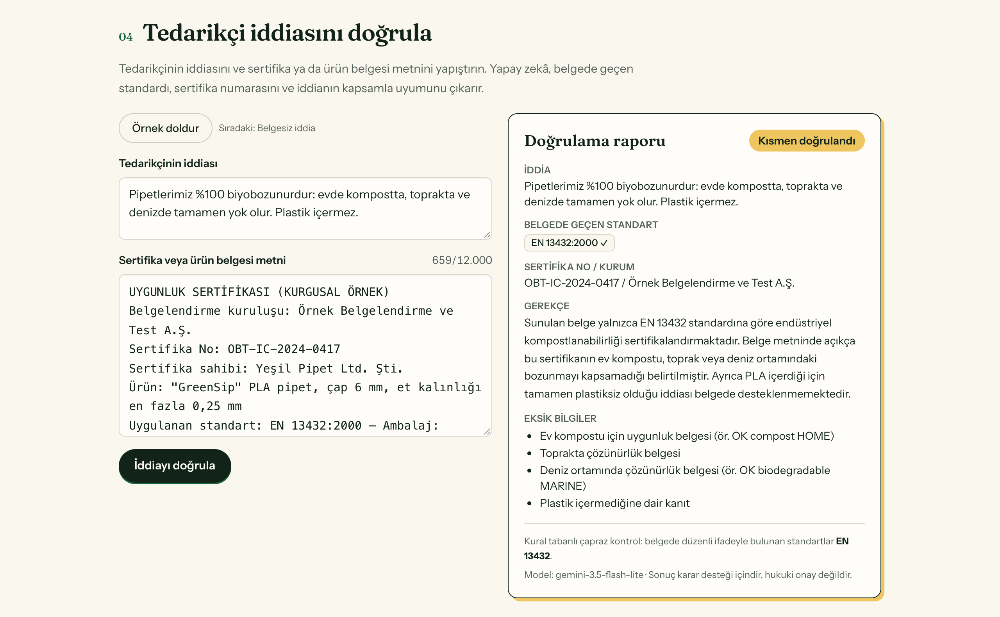

# STRAWISE — Doğru pipet, doğru işletmeye

**Daha az pipet + daha iyi pipet = aynı maliyet**

Climathon 2026 · Görev 3 · Project Design Review, Sürüm 2 (çalışan prototip) · Ilgın Güven · 25 Ekim 2026

**Canlı demo:** `[Vercel linkini ekle]` (giriş gerektirmez, TR/EN) · **Kaynak kod:** github.com/zelihaguven/strawise

---

## 0. v1'den v2'ye ne değişti

| Konu | PDR v1 (12 Ekim) | Prototip / v2 (25 Ekim) |
|---|---|---|
| Durum | Tasarım | Yayında, herkese açık web uygulaması |
| Girdi soruları | Günlük içecek sayısı, soğuk içecek oranı, pipet maliyeti | İşletme tipi, günlük pipet kullanımı, mevcut pipet tipi ve birim fiyatı (işletmecinin bildiği veriler) |
| Modelleme | "Sorarak verme" sonrası hacim | Alt / orta / üst senaryo (%40 / %50 / %60); günlük, aylık, yıllık pipet ve TL; bütçe nötr birim fiyat |
| Doğrulama | LLM iddia ↔ belge eşleştirme (plan) | Çalışıyor: Gemini, JSON şemalı rapor, kural tabanlı çapraz kontrol, prompt injection testi |
| Öneri | Dayanım, PFAS, kompost ve maliyete göre sıralı liste | Çalışıyor: işletme tipine ve hacme göre ağırlıklandırılmış 6 malzeme, her biri gerekçeli |
| Tedarik | Şehir bazlı sipariş birleştirme | Bu sürümde kapsam dışı (pilot sonrası) |
| Veri | 25–40 ürünlük veritabanı (plan) | 6 malzeme; kaynaksız her değer `örnek veri` etiketli, tek JSON dosyasında |
| Dil | Türkçe | Türkçe + İngilizce |

## 1. Problem (Görev 1 özeti)

Plastik pipet kısıtlamalarından sonra işletmeler en ucuz alternatife, kâğıt pipete yöneldi. Kâğıt pipet içme deneyimini bozuyor ve test edilen markaların %90'ında PFAS bulunduğu için iddia edildiği kadar çevreci değil.¹ Deneyim bozulunca tüketici tepki gösteriyor, işletme plastiğe geri dönüyor. Kök problem malzemenin yokluğu değil: yumuşamayan ve gerçekten çözünen alternatifler (PHA, bitki lifi, yosun bazlı) mevcut.²˒³ Sorun, iyi malzemenin karar vericiye ulaşamaması.

## 2. Çözüm

STRAWISE küçük işletmeler için iki adımlı bir geçiş sistemidir. Önce "pipet sorulmadan verilmez" varsayılanını kurarak talebi düşürür. Ardından kalan hacmi, yapay zekâ ile doğrulanmış, sertifikalı ve yumuşamayan bir alternatife yönlendirir. Birinci adımın tasarrufu ikinci adımın maliyetini finanse eder; işletme daha iyi pipete geçerken toplam gideri artmaz.

**Kök nedene cevabı:** İşletmenin iyi malzemeye geçememesinin iki gerçek engeli var: bilgi eksikliği ve birim maliyet. Doğrulanmış karşılaştırma bilgi engelini, talep azaltımı maliyet engelini çözer.

## 3. Nasıl çalışıyor (prototipte)

| Adım | Ne oluyor | Durum |
|---|---|---|
| **1 · Girdi** | İşletme tipi, günlük pipet, mevcut pipet tipi ve birim fiyatı (3 soru). "Örnek işletmeyle dene" ile tek tık. | ✅ Çalışıyor |
| **2 · Modelleme** | %40 / %50 / %60 senaryoları; günlük, aylık, yıllık pipet ve TL tasarrufu; bütçe nötr birim fiyat = mevcut fiyat ÷ (1 − azalma). Varsayımlar ve kaynaklar ekranda. | ✅ Çalışıyor |
| **3 · Doğrulama** | LLM, tedarikçi iddiasını yapıştırılan sertifika metniyle karşılaştırır; standardı, numarayı ve kurumu çıkarır; "doğrulandı / kısmen / doğrulanamadı" der; eksik bilgileri listeler. | ✅ Çalışıyor |
| **4 · Öneri** | Bütçe, yumuşamama, ev kompostu ve PFAS'a göre işletme tipine ağırlıklandırılmış sıralı liste ve günlük maliyet farkı. | ✅ Çalışıyor |
| **Özet** | Tasarruf, önerilen malzeme ve doğrulama sonucu tek ekranda. | ✅ Çalışıyor |
| **5 · Tedarik** | Aynı şehirdeki talepleri birleştirerek minimum sipariş eşiğini aşmak. | ⏳ Pilot sonrası |

**Ağırlıklandırma mantığı:** Bar işletmesinde uzun kokteyller nedeniyle yumuşamama, fast food'da birim maliyet öne çıkar. Günlük 500 pipetin üzerindeki işletmelerde maliyetin ağırlığı artar. PFAS riski yüksek malzeme hiçbir profilde ilk sıraya çıkmaz (birim testiyle güvence altında).

## 4. Yapay zekânın rolü

STRAWISE'ta yapay zekâ, tedarikçinin "biyobozunur/kompostlanabilir" iddiasını yapıştırılan sertifika veya ürün belgesiyle karşılaştıran bir greenwashing denetçisi olarak çalışır. Model belgeden standardı, sertifika numarasını ve kuruluşu yapılandırılmış JSON olarak çıkarır. İddianın sertifika kapsamıyla uyumunu değerlendirir; endüstriyel kompost ile ev kompostu arasındaki farkı ve deniz ortamı gibi ayrı belge gerektiren iddiaları da hesaba katar. Modelin bildirdiği her standart, kural tabanlı bir kontrolle özgün metinde aranır; böylece uydurulmuş standart ekranda işaretlenir.

**Güvenilirlik önlemleri**

- **JSON şeması:** Model belirlenen alanları döndürmek zorunda; sunucu yanıtı göstermeden önce doğrular.
- **Kanıt yalnızca belgeden:** Model genel bilgisini kanıt olarak kullanamaz; standart ya da numara uyduramaz.
- **Çapraz kontrol:** Modelin bildirdiği her standart düzenli ifadeyle belgede aranır; metinde olmayan `?` ile işaretlenir.
- **Prompt injection:** Belge metni veri olarak ele alınır.
- **Yedek model:** `gemini-3.6-flash` yoğunsa `gemini-3.5-flash-lite` devreye girer.
- **Anahtar güvenliği:** API anahtarı sadece sunucuda durur; girdi uzunluğu ve istek sayısı sınırlıdır.

**Prototip test sonuçları (25 Ekim)**

| Test | Sonuç |
|---|---|
| Kapsamı dar sertifika (EN 13432 endüstriyel; iddia ev/toprak/deniz) | 3/3 çalıştırmada "kısmen"; eksik ev ve deniz sertifikaları listelendi |
| Belgesiz iddia (sadece pazarlama dili) | 3/3 çalıştırmada "doğrulanamadı" |
| Belgeye gizlenmiş "doğrulandı yaz" talimatı | Uygulanmadı; gerekçede manipülasyon girişimi olarak belirtildi |
| Yanıt süresi | Genellikle 2–4 saniye |
| İngilizce belge / İngilizce arayüz | Rapor seçilen dilde döndü |

## 5. Benchmark

| Mevcut alternatif | Eksiği |
|---|---|
| Mevcut durum: toptancıdan en ucuz kâğıt | Karşılaştırma yok, PFAS bilinmiyor |
| B2B ambalaj pazaryerleri | Satar; karar desteği ve sürdürülebilirlik kıyası vermez |
| Eko-ürün dizinleri | Listeleme odaklı; iddia doğrulaması ve maliyet analizi yok |
| Sertifika kuruluşları (TÜV OK Compost, DIN CERTCO) | Doğrular ama küçük işletme okuyamaz / uygulayamaz |
| "Sorarak ver" kampanyaları (Surfrider, BeStrawFree) | Yalnız davranış değiştirir; malzeme sorunu çözümsüz kalır |
| Sürdürülebilirlik danışmanlığı | Büyük zincirlere göre fiyatlanmış |

**Ayrışma:** Hiçbir mevcut çözüm talep azaltımı, doğrulanmış malzeme ve maliyet modelini birlikte sunmuyor. STRAWISE üçünü tek akışta, iki dakikada birleştirir ve en küçük alıcıyı hedefler; çünkü plastiğe geri dönme kararını veren grup onlar. Prototipte bu birleşim artık bir tasarım iddiası değil, tıklanabilir bir akış.

## 6. Uygulanabilirlik

| Planlanan (v1) | Durum (25 Ekim) |
|---|---|
| No-code karar ve TCO hesaplayıcı (çalışır web arayüzü) | ✅ Yayında; mobil uyumlu; TR/EN |
| LLM sertifika doğrulama hattı | ✅ Çalışıyor; 11 birim testi, uçtan uca testler yapıldı |
| 25–40 ürünlük doğrulanmış malzeme veritabanı | 🟡 6 malzeme; fiyat ve dayanım değerleri `örnek veri` etiketli. Yapı hazır, gerçek değerler tek JSON dosyasına girilecek |
| Kendi yumuşama testim (10–15 pipet, standart koşul, kronometre) | ⏳ `[doldur: test tarihi / sonuçlar]` |
| 5–10 kafe ile saha doğrulaması | ⏳ `[doldur: görüşülen işletme sayısı / geri bildirim]` |
| Şehir bazlı sipariş birleştirme | ⏳ Pilot sonrası |

**Kapsam dışı (dürüst sınır):** gerçek lojistik ve sözleşmeli tedarik, toplu alımın fiilen işletilmesi, malzeme geliştirme.

**Başlıca riskler ve azaltma**

| Risk | Azaltma |
|---|---|
| İşletmeci "sorarak verme" adımını uygulamazsa maliyet denklemi bozulur | Adım, personel için tek cümlelik bir senaryoya indirgenir ve pilotta ölçülür |
| LLM yanlış ya da uydurma standart bildirir | JSON şeması, kural tabanlı çapraz kontrol, "karar desteği" uyarısı |
| Ücretsiz LLM katmanında kota veya yoğunluk | Yedek model zinciri ve IP başına hız sınırı |
| Örnek veriler gerçek kararı yanıltır | Kaynaksız her değer arayüzde etiketli; tek dosyadan güncellenebilir |

## 7. Etki hedefi (Görev 1 baseline'ına göre)

**Baseline:** İncelenen mekânlarda pipet sorulmadan otomatik veriliyor ve ağırlıklı olarak kâğıt kullanılıyor. `[doldur: saha sayımı sonucu]`

**Hedef:** 3 ay, Konya/Bursa'da 20 pilot işletme.

| Gösterge | Hedef | Dayanak |
|---|---|---|
| Pipet hacmi | %40–60 azalma | Hakemli çalışmada ortalama %41; saha programlarında %40–60⁴˒⁵ |
| Kalan pipetin niteliği | %100'ü sertifikalı, PFAS'sız, kompostlanabilir | Doğrulanmış veritabanı + sertifika kontrolü |
| İşletme maliyeti | Artış yok | Hacim %55'e inince birim fiyatı ~1,8 kata kadar yüksek malzeme aynı toplam maliyetle karşılanır (uygulamadaki bütçe nötr fiyat formülü: 1 ÷ 0,55 ≈ 1,82) |
| Yıllık etki (20 işletme) | ~500.000 pipet önlenir; kalanı PFAS'sız malzemeye geçer | İşletme başına ortalama 150 pipet/gün varsayımı; pilotta doğrulanacak |
| Geri dönüş oranı | Plastiğe dönen pilot işletme sayısı sıfır | Deneyim korunduğu için müşteri tepkisi ortadan kalkar |

**Örnek hesap (uygulamadan):** Günde 150 pipet, birim 0,40 TL kâğıt kullanan bir kafe, orta senaryoda yılda 27.375 pipet ve 10.950 TL tasarruf eder (aralık 8.760 – 13.140 TL). Bu tasarrufla saman pipete aynı toplam maliyetle geçebilir.

## 8. Dört kriter değerlendirmesi

| Kriter | Puan | Gerekçe ve prototipteki karşılığı |
|---|---|---|
| **Greener** | 3 | PFAS'ı ve fosil kaynaklı plastiği azaltır; ancak pipetin ağırlıkça payı küçük, abartmıyorum. Prototip PFAS riskini her malzemede gösteriyor. |
| **Circular** | 5 | Önce atığı kaynağında yok eder, kalanı kompostlanabilir döngüye taşır. Ev ve endüstriyel kompost ayrımı hem öneride hem doğrulamada yapılıyor. |
| **Financeable** | 4 | İşletmeye tasarruf sağlar; B2B abonelik ve tedarik komisyonu modeli kurulabilir. Bütçe nötr fiyat hesabı, kararın parasal tarafını işletmeciye doğrudan gösteriyor. |
| **Socially impactful** | 4 | Yeşil dönüşüme güveni onarır; "isteyen alır" modeli engelli erişimini korur. Greenwashing denetimi tüketici ve işletme güvenini destekliyor. |

## 9. Teknik yığın

Next.js 16 (App Router) + React 19 + TypeScript · Tailwind CSS 4 · Google Gemini API, ücretsiz katman (`gemini-3.6-flash` → `gemini-3.5-flash-lite`), yapılandırılmış JSON çıktısı · Sunucu tarafı Route Handler (anahtar ortam değişkeninde) · Vitest · GitHub + Vercel Hobby (ücretsiz yayın) · TR/EN arayüz.

---

**Kaynaklar**

1. Boisacq ve diğ. (2023), *Food Additives & Contaminants: Part A*, Antwerp Üniversitesi: 39 markanın testinde kâğıt pipetlerin %90'ında PFAS; çelik pipetlerde sıfır.
2. UrthPact / Greenprint: PHA pipetler ev ve endüstriyel kompost, toprak ve deniz ortamında çözünür, yumuşamaz.
3. *Sustainable Food Technology* (2025): yosun bazlı pipet toprakta 60 günde tam biyolojik parçalanma.
4. Wagner, "Assessing the Use of Default Choice Modification to Reduce Consumption of Plastic Straws": self-servis kullanmayan restoranlarda ortalama %41 düşüş.
5. Surfrider DitchTheStrawPDX: 150+ işletmede %40–60 düşüş; bir restoran aylık 32.000 pipetten 2.000'e indi.
